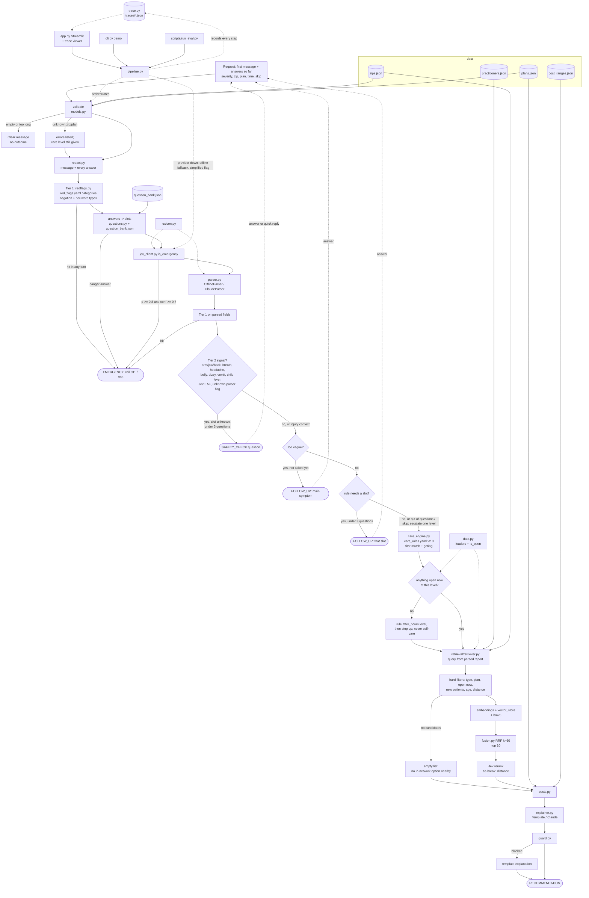

# Context graph

Living map of the system. Read this and `decisions.md` before any task; update it at the end of every phase.

Last updated: 2026-10-27, Prompt1 Parts A and B done.

## Request flow

## Nodes

| Node | Type | Depends on | Used by | Tests | Related decisions | Status |
|---|---|---|---|---|---|---|
| `navigator/__init__.py` | module | - | everything | `test_smoke.py` | - | done |
| `navigator/config.py` | config | env vars, `.env` (via `load_env_file`, entry points only) | redflags, jev_client, parser, care_engine (gating) | `test_config.py` | D-003, D-004, D-008, D-014, D-019, D-023, D-024 | done |
| `.env.example` / `.env` | config | - | `config.load_env_file` | `test_config.py` | D-024 | done (`.env` gitignored) |
| `tests/conftest.py` | test | pytest | every test | - | D-008, D-024 | done |
| `navigator/models.py` | module | pydantic | all modules | `test_models.py` | D-001, D-003 | done |
| `navigator/redact.py` | module | - | pipeline, trace | `test_redact.py` | D-009 | done |
| `navigator/redflags.py` + `red_flags.yaml` | module + config | rapidfuzz (JaroWinkler), pyyaml, config, models | pipeline, questions | `test_redflags.py`, `test_conversation.py` | D-015, D-016, D-041 | done (v2.0, three tiers) |
| `navigator/questions.py` | module | data/question_bank.json, redflags.TextView | pipeline, clarifier, run_eval | `test_conversation.py` | D-041 | done |
| `navigator/lexicon.py` | module | - | jev_client, parser | via `test_jev_client.py`, `test_parser.py` | D-021 | done |
| `navigator/jev_client.py` | module | config, lexicon, redflags.normalize, requests | pipeline, retriever, guard | `test_jev_client.py` | D-002, D-004, D-008, D-019, D-023 | done (all question types verified live) |
| `navigator/parser.py` | module | models, config, lexicon, redflags, anthropic | pipeline | `test_parser.py` | D-004, D-008, D-009, D-018, D-020 | done |
| `navigator/clarifier.py` | module | models, config, questions, jev_client (guard), anthropic | pipeline | `test_clarifier.py` | D-004, D-028, D-041 | done (bank questions; Claude rephrases only) |
| `navigator/care_engine.py` + `care_rules.yaml` | module + config | models, data, pyyaml | pipeline | `test_care_engine.py` | D-001, D-025, D-026, D-034, D-036, D-042 | done (25 rules, v2.0, slots + needs) |
| `navigator/data.py` | module | data/*.json, models | care_engine, retrieval | `test_care_engine.py` | D-027 | done |
| `navigator/retrieval/embeddings.py` | module | scikit-learn, requests, config | retriever | `test_retrieval.py` | D-008, D-030 | done (Voyage not run live) |
| `navigator/retrieval/vector_store.py` | module | numpy | retriever | `test_retrieval.py` | D-006, D-029 | done |
| `navigator/retrieval/bm25.py` | module | rank-bm25 | retriever | `test_retrieval.py` | D-006, D-030 | done |
| `navigator/retrieval/fusion.py` | module | config | retriever | `test_retrieval.py` | D-006 | done |
| `navigator/retrieval/retriever.py` | module | all retrieval, jev_client, data, models | pipeline, run_eval | `test_retrieval.py` | D-005, D-006, D-030, D-040 | done |
| `navigator/costs.py` | module | data, models, config | pipeline | `test_costs.py` | D-035, D-044 | done (deductible applies, waived if admitted, cash prices) |
| `navigator/explainer.py` | module | models, care_engine (labels, rule reasons), anthropic | pipeline, guard | `test_explainer_guard.py` | D-004, D-007, D-034 | done (Claude not run live) |
| `navigator/guard.py` | module | jev_client, explainer, data | pipeline | `test_explainer_guard.py`, `test_pipeline.py` | D-007, D-034 | done |
| `navigator/trace.py` | module | redact, models | pipeline, app | `test_trace.py`, `test_pipeline.py` | D-009, D-035 | done |
| `navigator/pipeline.py` | module | everything above | app, cli, run_eval | `test_pipeline.py` | D-001..D-009, D-031, D-033 | done |
| `app.py` | module | pipeline, config, data, streamlit | user (`make app`) | `test_app.py` | D-038, D-039 | done |
| `cli.py` | module | pipeline, config | `make demo` | `test_cli.py` | D-038 | done |
| `scripts/run_eval.py` | module | pipeline, data, data/eval | `make eval` | `test_run_eval.py` | D-038 | done |
| `data/generate.py` + `eval_sets.py` + `expansion.py` | data | - | data files | `test_data.py`, `test_data_insurance.py`, `test_generate.py` | D-010, D-013, D-044 | done |
| `data/zips.json` | data | generate.py | validate, retriever | `test_data.py`, `test_data_insurance.py` | D-010, D-011, D-044 | done (12 zips, 3 towns, area_type) |
| `data/plans.json` | data | generate.py | validate, costs | `test_data.py`, `test_data_insurance.py` | D-010, D-044 | done (10 plans, per-service cost sharing) |
| `data/practitioners.json` | data | generate.py | retriever, care_engine | `test_data.py`, `test_data_insurance.py` | D-010, D-012, D-044, D-045 | done (73 records, B3 network rules) |
| `data/coverage_gaps.json` | data | generate.py (expansion.coverage_gaps) | data README, tests | `test_data_insurance.py` | D-044 | done (34 gaps at 15 km) |
| `data/cost_ranges.json` | data | generate.py | costs | `test_data.py`, `test_generate.py` | D-010, D-011, D-013 | done |
| `data/eval/*.jsonl` | data | eval_sets.py | tests, run_eval | `test_data.py`, `test_generate.py`, `test_conversation.py` | D-013, D-041 | done (+ near_misses 21, conversations 12) |
| `data/question_bank.json` (+ `question_bank_src.py`) | data | generate.py | questions, clarifier | `test_conversation.py`, `test_generate.py` | D-041 | done (15 slots) |
| `pyproject.toml`, `requirements.txt`, `Makefile` | config | - | dev workflow | - | - | done |
| `README.md` | doc | everything | reviewers | - | - | done |

## Current status

- Done: Phases 0 to 8. Prompt1 Part A (three-tier red flags, question bank, conversations; D-041 to D-043). Prompt1 Part B (10 plans, 12 zips in 3 towns, 73 practitioners, network rules, coverage_gaps.json, cost display; D-044 to D-046).
- Tests: 1,143 passing offline with no API keys.
- Offline eval: red-flag recall 100% (40/40), false-emergency rate 0% (0/64), routing 100% (44/44) with 0 below expected, vague -> question 100% (15/15), adversarial 100% (10/10), near misses 100% (21/21), conversations 100% (12/12), 0.39 questions on average (77 runs), 0 over 3 questions, retrieval recall@3 100% (30 queries), 0 filter violations.
- In progress: -
- Not started: -

## Open questions

- D-045: confirm that the pediatric ER (ER-004) should list the senior plan because every ER accepts every plan.
- The 3 km "nearby" radius (D-031) suits urban Corvalle; rural Pinecrest requests usually get online alternatives only. A radius by `area_type` would need a decision.

- The Voyage key hits its rate limit (HTTP 429) after one query in quick succession; requests fall back to offline search (D-037).
- Live Jev rerank sends one score question per document (up to 10) in one request; cost per search is roughly 10x a single classification.

- `make` is not installed on the dev machine (Windows); Makefile targets are plain one-liners that can be run directly.
- `make eval` with keys in `.env` runs live (about 140 conversation runs, each re-running the pipeline per answer); the live eval hasn't been run end to end.
- The Sonnet 5.5 evaluation judge (D-004) isn't implemented (D-038).
