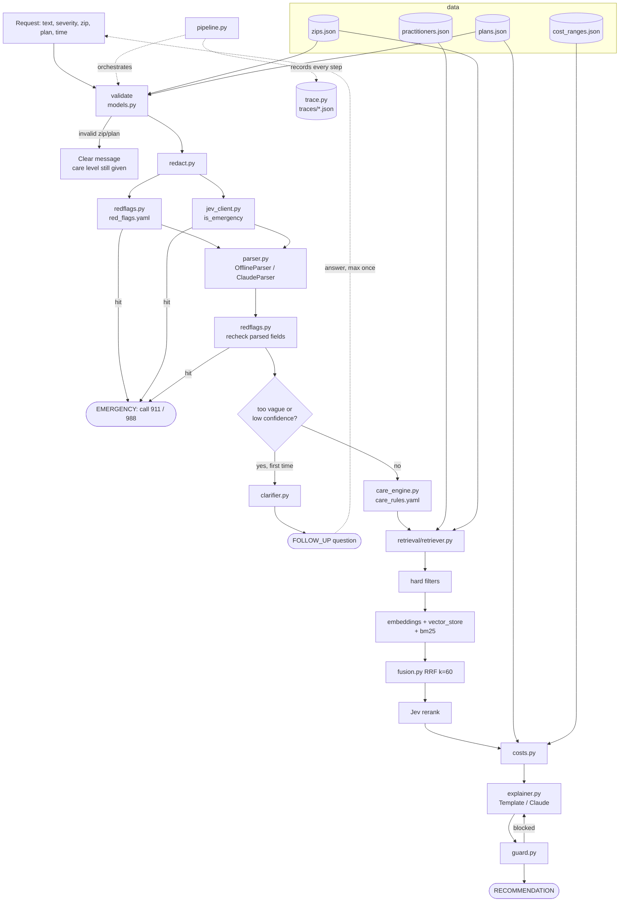

# Context graph

Living map of the system. Read this and `decisions.md` before any task; update it at the end of every phase.

Last updated: 2026-10-27, end of Phase 1.

## Request flow

## Nodes

| Node | Type | Depends on | Used by | Tests | Related decisions | Status |
|---|---|---|---|---|---|---|
| `navigator/__init__.py` | module | - | everything | `test_smoke.py` | - | done |
| `navigator/config.py` | config | env vars | all model adapters, gating | - | D-004, D-008 | not started |
| `navigator/models.py` | module | pydantic | all modules | - | D-001 | not started |
| `navigator/redact.py` | module | - | pipeline, trace | - | D-009 | not started |
| `navigator/redflags.py` + `red_flags.yaml` | module + config | rapidfuzz | pipeline | - | D-002 | not started |
| `navigator/jev_client.py` | module | config | pipeline, retriever, guard | - | D-004, D-008 | not started |
| `navigator/parser.py` | module | models, config, anthropic | pipeline | - | D-004, D-008, D-009 | not started |
| `navigator/clarifier.py` | module | models | pipeline | - | D-003 | not started |
| `navigator/care_engine.py` + `care_rules.yaml` | module + config | models, practitioners.json | pipeline | - | D-001, D-003 | not started |
| `navigator/retrieval/embeddings.py` | module | scikit-learn | vector_store | - | D-008 | not started |
| `navigator/retrieval/vector_store.py` | module | embeddings, numpy | retriever | - | D-006 | not started |
| `navigator/retrieval/bm25.py` | module | rank-bm25 | retriever | - | D-006 | not started |
| `navigator/retrieval/fusion.py` | module | - | retriever | - | D-006 | not started |
| `navigator/retrieval/retriever.py` | module | all retrieval, jev_client, data | pipeline | - | D-005, D-006 | not started |
| `navigator/costs.py` | module | plans.json, cost_ranges.json | pipeline, explainer | - | - | not started |
| `navigator/explainer.py` | module | models, anthropic | pipeline | - | D-007 | not started |
| `navigator/guard.py` | module | jev_client | pipeline | - | D-007 | not started |
| `navigator/trace.py` | module | redact | pipeline, app | - | D-009 | not started |
| `navigator/pipeline.py` | module | everything above | app, cli, run_eval | - | D-001..D-009 | not started |
| `app.py` | module | pipeline, streamlit | user | - | - | not started |
| `cli.py` | module | pipeline | `make demo` | - | - | not started |
| `scripts/run_eval.py` | module | pipeline, data/eval | `make eval` | - | - | not started |
| `data/generate.py` + `eval_sets.py` | data | - | data files | `test_data.py`, `test_generate.py` | D-010, D-013 | done |
| `data/zips.json` | data | generate.py | validate, retriever | `test_data.py`, `test_generate.py` | D-010, D-011, D-013 | done |
| `data/plans.json` | data | generate.py | validate, costs | `test_data.py`, `test_generate.py` | D-010, D-011, D-013 | done |
| `data/practitioners.json` | data | generate.py | retriever, care_engine | `test_data.py`, `test_generate.py` | D-010, D-011, D-012, D-013 | done |
| `data/cost_ranges.json` | data | generate.py | costs | `test_data.py`, `test_generate.py` | D-010, D-011, D-013 | done |
| `data/eval/*.jsonl` | data | eval_sets.py | tests, run_eval | `test_data.py`, `test_generate.py` | D-013 | done |
| `pyproject.toml`, `requirements.txt`, `Makefile` | config | - | dev workflow | - | - | done |

## Current status

- Done: Phase 0 scaffold. Phase 1 synthetic data (provided; 14 data tests + 2 determinism tests passing; generator now byte-identical across OSes, D-013).
- In progress: -
- Not started: Phases 2 to 8.

## Open questions

- `make` is not installed on the dev machine (Windows); Makefile targets are plain one-liners that can be run directly.
