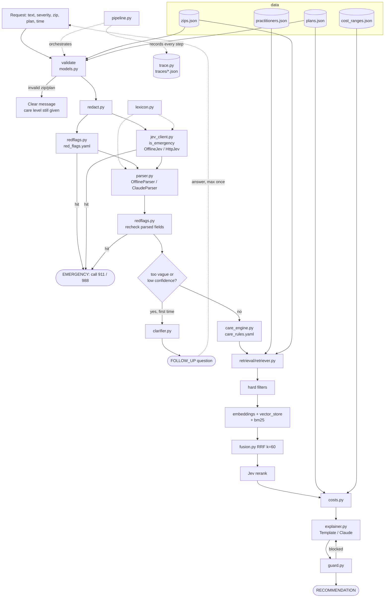

# Context graph

Living map of the system. Read this and `decisions.md` before any task; update it at the end of every phase.

Last updated: 2026-10-27, end of Phase 3.

## Request flow

## Nodes

| Node | Type | Depends on | Used by | Tests | Related decisions | Status |
|---|---|---|---|---|---|---|
| `navigator/__init__.py` | module | - | everything | `test_smoke.py` | - | done |
| `navigator/config.py` | config | env vars, `.env` (via `load_env_file`, entry points only) | redflags, jev_client, parser, care_engine (gating) | `test_config.py` | D-003, D-004, D-008, D-014, D-019, D-023, D-024 | done |
| `.env.example` / `.env` | config | - | `config.load_env_file` | `test_config.py` | D-024 | done (`.env` gitignored) |
| `tests/conftest.py` | test | pytest | every test | - | D-008, D-024 | done |
| `navigator/models.py` | module | pydantic | all modules | `test_models.py` | D-001, D-003 | done |
| `navigator/redact.py` | module | - | pipeline, trace | `test_redact.py` | D-009 | done |
| `navigator/redflags.py` + `red_flags.yaml` | module + config | rapidfuzz, pyyaml, config, models | pipeline | `test_redflags.py` | D-002, D-014, D-015, D-016, D-017 | done |
| `navigator/lexicon.py` | module | - | jev_client, parser | via `test_jev_client.py`, `test_parser.py` | D-021 | done |
| `navigator/jev_client.py` | module | config, lexicon, redflags.normalize, requests | pipeline, retriever, guard | `test_jev_client.py` | D-002, D-004, D-008, D-019, D-023 | done (HttpJev matches TypeSafe docs; live `noul` call verified) |
| `navigator/parser.py` | module | models, config, lexicon, redflags, anthropic | pipeline | `test_parser.py` | D-004, D-008, D-009, D-018, D-020 | done |
| `navigator/clarifier.py` | module | models | pipeline | - | D-003 | not started |
| `navigator/care_engine.py` + `care_rules.yaml` | module + config | models, practitioners.json | pipeline | - | D-001, D-003 | not started |
| `navigator/retrieval/embeddings.py` | module | scikit-learn | vector_store | - | D-008 | not started |
| `navigator/retrieval/vector_store.py` | module | embeddings, numpy | retriever | - | D-006 | not started |
| `navigator/retrieval/bm25.py` | module | rank-bm25 | retriever | - | D-006 | not started |
| `navigator/retrieval/fusion.py` | module | - | retriever | - | D-006 | not started |
| `navigator/retrieval/retriever.py` | module | all retrieval, jev_client, data | pipeline | - | D-005, D-006 | not started |
| `navigator/costs.py` | module | plans.json, cost_ranges.json | pipeline, explainer | - | - | not started |
| `navigator/explainer.py` | module | models, anthropic | pipeline | - | D-007 | not started |
| `navigator/guard.py` | module | jev_client | pipeline | - | D-007 | not started |
| `navigator/trace.py` | module | redact | pipeline, app | - | D-009 | not started |
| `navigator/pipeline.py` | module | everything above | app, cli, run_eval | - | D-001..D-009 | not started |
| `app.py` | module | pipeline, streamlit | user | - | - | not started |
| `cli.py` | module | pipeline | `make demo` | - | - | not started |
| `scripts/run_eval.py` | module | pipeline, data/eval | `make eval` | - | - | not started |
| `data/generate.py` + `eval_sets.py` | data | - | data files | `test_data.py`, `test_generate.py` | D-010, D-013 | done |
| `data/zips.json` | data | generate.py | validate, retriever | `test_data.py`, `test_generate.py` | D-010, D-011, D-013 | done |
| `data/plans.json` | data | generate.py | validate, costs | `test_data.py`, `test_generate.py` | D-010, D-011, D-013 | done |
| `data/practitioners.json` | data | generate.py | retriever, care_engine | `test_data.py`, `test_generate.py` | D-010, D-011, D-012, D-013 | done |
| `data/cost_ranges.json` | data | generate.py | costs | `test_data.py`, `test_generate.py` | D-010, D-011, D-013 | done |
| `data/eval/*.jsonl` | data | eval_sets.py | tests, run_eval | `test_data.py`, `test_generate.py` | D-013 | done |
| `pyproject.toml`, `requirements.txt`, `Makefile` | config | - | dev workflow | - | - | done |

## Current status

- Done: Phase 0 scaffold. Phase 1 synthetic data (D-013). Phase 2 schemas (`models.py`, incl. ordered `CareLevel.escalate`), PII redaction, keyword + fuzzy red-flag screen. Phase 3 config (env switches, model ids, thresholds, confidence gate), shared lexicon, Jev interface (OfflineJev + HttpJev), parser interface (OfflineParser + ClaudeParser with one retry and offline fallback).
- Red-flag coverage: keyword screen 33/40; OfflineJev 12/12 of the `parsed_or_jev` cases; combined 40/40 (D-015, D-019).
- In progress: -
- Not started: Phases 4 to 8.

## Open questions

- HttpJev follows the TypeSafe Jev API reference (D-023). One live `noul` call succeeded; `choice` (category) and `score` (urgency, rerank) are verified only against mocked HTTP.
- Phase 7 entry points must call `config.load_env_file()` (D-024).
- Many routing cases state no duration, so OfflineParser marks them `medium` confidence, which the gate escalates one level. Phase 4 must check this doesn't push cases above `acceptable_levels` (for example, treat a missing duration as "escalate" only when the matched rule depends on duration).

- Negation ("no chest pain") still fires the red-flag screen (D-017). Acceptable over-triage for the prototype?

- `make` is not installed on the dev machine (Windows); Makefile targets are plain one-liners that can be run directly.
